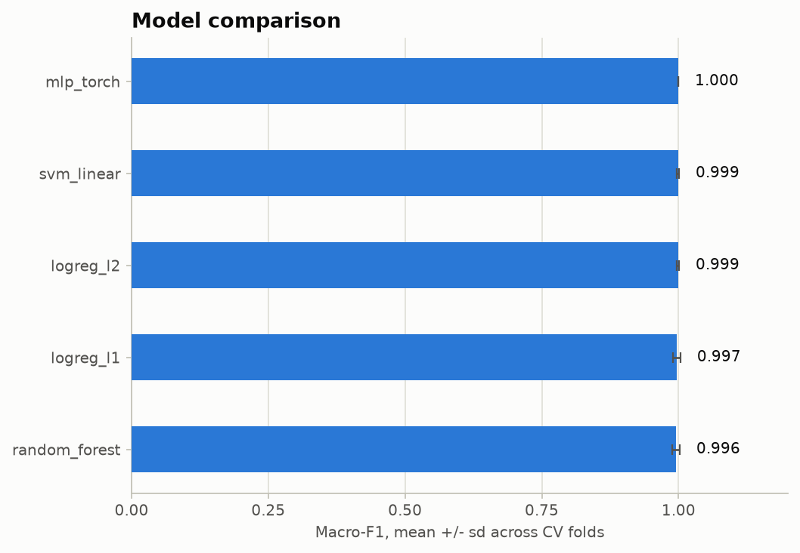
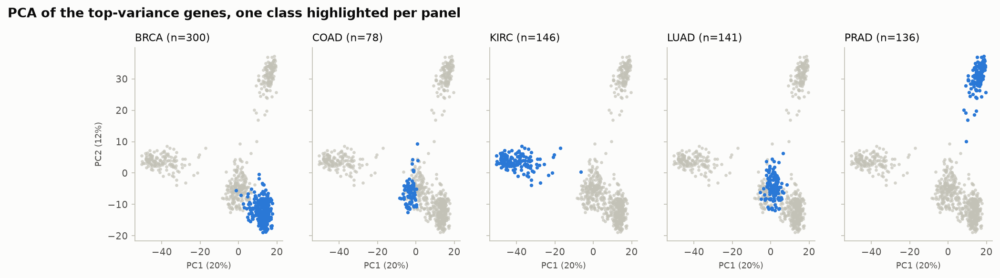
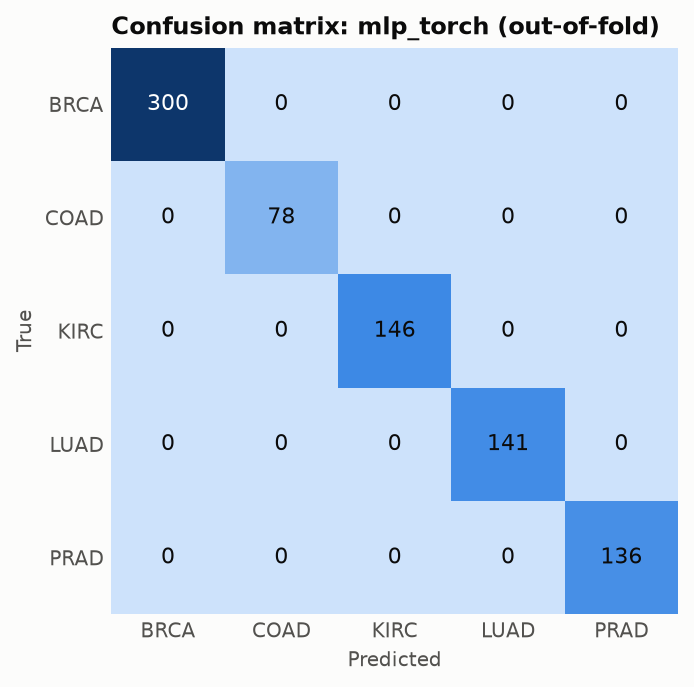

# gene-expression-cancer-subtyping

[](https://github.com/AzeemDgreat/gene-expression-cancer-subtyping/actions/workflows/ci.yml)


Classify tumour type from RNA-Seq gene expression, with differential expression analysis and a leakage-safe comparison of four model families. Part of my [BioComputation](https://github.com/AzeemDgreat/BioComputation) portfolio.

## Question

Can the cancer type of a tumour (breast, colon, kidney, lung or prostate) be predicted from its gene expression profile, and which genes carry the signal?

## Data

[UCI Gene Expression Cancer RNA-Seq](https://archive.ics.uci.edu/dataset/401/gene+expression+cancer+rna+seq): a random extraction of TCGA PANCAN RNA-Seq (Illumina HiSeq) data.

| | |
|---|---|
| Samples | 801 tumours |
| Features | 20,531 genes |
| Classes | BRCA (breast), COAD (colon), KIRC (kidney), LUAD (lung), PRAD (prostate) |
| License | CC BY 4.0 |
| Citation | Weinstein et al., *The Cancer Genome Atlas Pan-Cancer analysis project*, Nature Genetics 45, 1113-1120 (2013). UCI record DOI: 10.24432/C5R88H |

The data are downloaded by a script and never committed to this repository.

### Limitations of this dataset

- **Genes are anonymous** (`gene_0` ... `gene_20530`). The analysis can show *which columns* discriminate the cancer types, but it cannot name those genes or run pathway or enrichment analysis.
- **The values are not raw counts.** The scale check found non-integer values from 0 to 20.8 (mean 6.4, 14% exact zeros), consistent with log-scale normalized data (`results/scale_report.json`). Count-based tools such as DESeq2 or PyDESeq2 require raw integer counts, so differential expression here uses rank-based tests instead.
- Five classes of fairly distinct tissues is an easier problem than fine-grained subtyping within one cancer. High scores here do not imply the same performance on harder tasks.

## Method

1. **Scale check.** Reports min, max, whether values are integers, and what that implies.
2. **Differential expression** (exploratory, on all samples): Kruskal-Wallis across the five classes for every gene, plus one-vs-rest Mann-Whitney U tests per class, with Benjamini-Hochberg false discovery rate correction. `mean_diff` is the difference of group means on the data's own scale.
3. **Classification** with stratified 5-fold cross-validation. Each model is a scikit-learn `Pipeline`, so everything below is refitted on each training fold only:
   - top 5,000 genes by variance
   - top 500 genes by Kruskal-Wallis p-value
   - standardisation
   - classifier
4. **Models:** logistic regression (L2), logistic regression (L1, sparse), linear SVM, random forest, and a small PyTorch MLP (128 and 32 hidden units, dropout 0.3).
5. **Metrics:** accuracy and macro-F1 (mean and standard deviation across folds), per-class precision/recall/F1, and confusion matrices from out-of-fold predictions.

### Avoiding data leakage

Choosing genes with the labels *before* cross-validation lets test-set information leak into the features and inflates scores, which is a common mistake with 20,000 features and 800 samples. Here selection happens inside each training fold. A test (`test_selection_inside_pipeline_does_not_leak`) checks this: on pure noise with random labels, accuracy stays near chance.

The differential expression tables use all samples and are descriptive. They do not feed the classifiers' evaluation.

## Results

<!-- RESULTS:START -->
One run with seed 42, 5-fold stratified cross-validation on all 801 samples (about 6 minutes on CPU; Python 3.11, scikit-learn 1.9.1, PyTorch 2.14.1). Class sizes: BRCA 300, KIRC 146, LUAD 141, PRAD 136, COAD 78.

| Model | Accuracy | Macro-F1 | Errors (of 801) |
|---|---|---|---|
| `mlp_torch` | 1.0000 ± 0.0000 | 1.0000 ± 0.0000 | 0 |
| `logreg_l2` | 0.9988 ± 0.0028 | 0.9989 ± 0.0024 | 1 |
| `svm_linear` | 0.9988 ± 0.0028 | 0.9989 ± 0.0024 | 1 |
| `logreg_l1` | 0.9962 ± 0.0084 | 0.9968 ± 0.0071 | 3 |
| `random_forest` | 0.9950 ± 0.0081 | 0.9958 ± 0.0069 | 4 |

Mean ± standard deviation across the 5 folds. "Errors" counts out-of-fold misclassifications.



### What the results show

- **All five model families classify these tissues almost perfectly.** The most errors any model makes is 4 out of 801 samples, and the differences between models are 1 to 4 samples. That is too small to rank the models: a single run with a fixed seed and untuned hyperparameters cannot separate them. The reasonable reading is that the problem is easy for any of them, not that the neural network is better.
- **The few errors are mistakes into BRCA.** Every misclassification in every model is a KIRC or LUAD sample predicted as BRCA, never the other way round and never involving COAD or PRAD. `results/confusion_<model>.csv` has the counts.
- **The classes are well separated before any model is fitted.** In the PCA below, kidney (KIRC) and prostate (PRAD) sit clearly apart from the rest in the first two components, while breast, colon and lung overlap more. The overlap is consistent with where the few errors fall (LUAD and KIRC into BRCA). I haven't tested that explanation.





### Differential expression

- **19,670 of 20,531 genes (96%) differ across the five types** at Benjamini-Hochberg q < 0.05 (Kruskal-Wallis). With 801 samples and very different tissues, nearly every gene shifts somewhere, so q < 0.05 does not single genes out here. Rank by statistic or effect size instead, which is how the tables are sorted.
- The strongest genes by Kruskal-Wallis statistic are `gene_7964`, `gene_11059`, `gene_18214`, `gene_13976` and `gene_16131` (full list in `results/de_kruskal_top.csv`; per-class results in `results/de_one_vs_rest_top.csv`).
- Because gene names are anonymised in this dataset, these are column labels only. I cannot say what these genes are or what they do.

### Caveats

- These are scores on an easy five-class tissue problem, so they say little about fine-grained subtyping within one cancer type, which is much harder.
- There is no held-out test set beyond cross-validation, no hyperparameter search, and one random split. Treat differences between models as noise.
- TCGA samples from the same patient or batch may share technical signal that this dataset gives no way to check. External validation on an independent cohort would be the proper next step.
<!-- RESULTS:END -->

## Reproduce

```bash
git clone https://github.com/AzeemDgreat/gene-expression-cancer-subtyping.git
cd gene-expression-cancer-subtyping
python -m venv .venv && source .venv/bin/activate    # Windows: .venv\Scripts\activate
pip install -r requirements.txt

python scripts/download_data.py      # about 70 MB, writes data/data.csv and data/labels.csv
python scripts/run_pipeline.py       # writes tables and figures to results/
```

Useful options: `--seed`, `--n-splits`, `--n-genes`, `--skip-mlp`, and `--synthetic` for a fast dry run on generated data (the numbers from a synthetic run mean nothing biologically).

With Docker:

```bash
docker build -t gexpr .
docker run --rm -v "$PWD/data:/app/data" -v "$PWD/results:/app/results" gexpr \
  sh -c "python scripts/download_data.py && python scripts/run_pipeline.py"
```

## Outputs (`results/`)

| File | Content |
|---|---|
| `scale_report.json` | What the expression values look like (range, integer or not) |
| `de_kruskal_top.csv` | Top genes across all five classes, with BH q-values |
| `de_one_vs_rest_top.csv` | Top genes per class, with mean difference and q-value |
| `cv_summary.csv`, `cv_metrics_per_fold.csv` | Accuracy and macro-F1 per model and fold |
| `per_class_report.csv`, `confusion_<model>.csv` | Per-class metrics and confusion counts |
| `oof_predictions.csv` | Out-of-fold prediction for every sample and model |
| `figures/` | Model comparison, best-model confusion matrix, PCA by class |
| `run_info.json` | Seed, settings, runtime and library versions |

## Project layout

```
src/gexpr/    data, preprocess, differential_expression, models, evaluate
scripts/      download_data.py, run_pipeline.py
tests/        pytest suite on small generated data (no downloads)
results/      outputs of a run
```

## Testing

```bash
pytest -q
ruff check .
```

The tests use small generated data and cover data validation, the scale check, the statistical tests against SciPy and a hand-computed Benjamini-Hochberg example, the PyTorch model, the leakage guard, figure output, an end-to-end run, and safe archive extraction.

## License

MIT. See [LICENSE](LICENSE). The dataset has its own license (CC BY 4.0).
